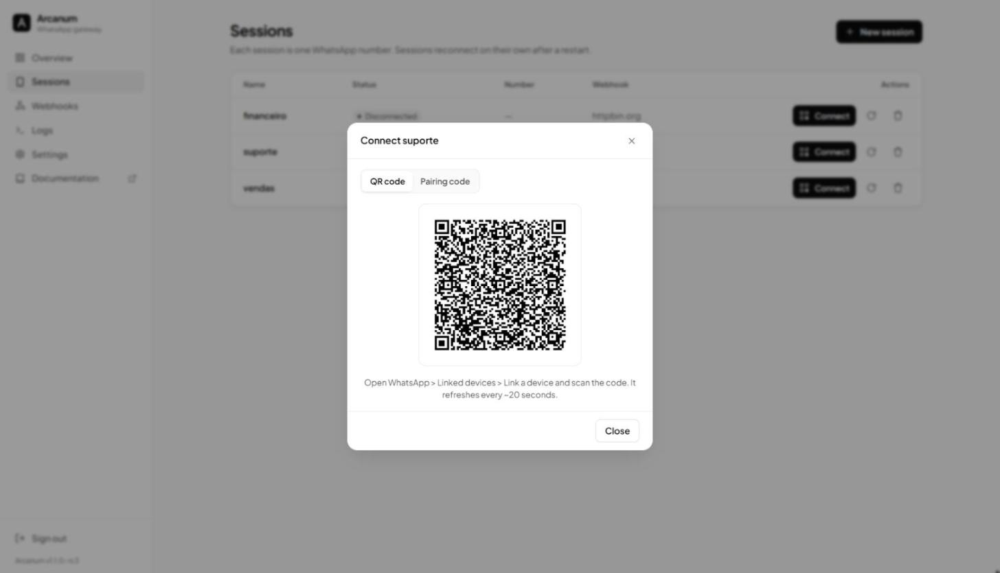
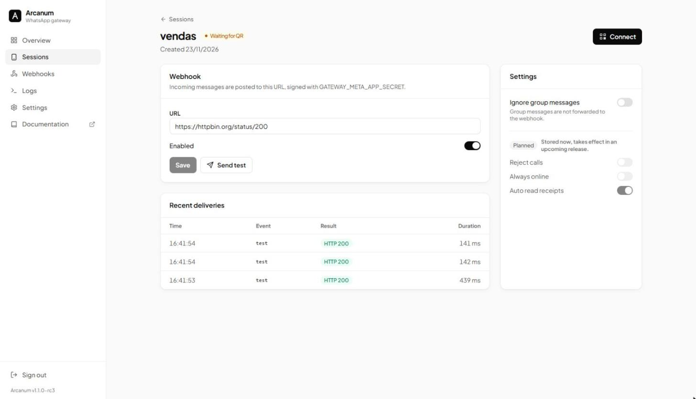
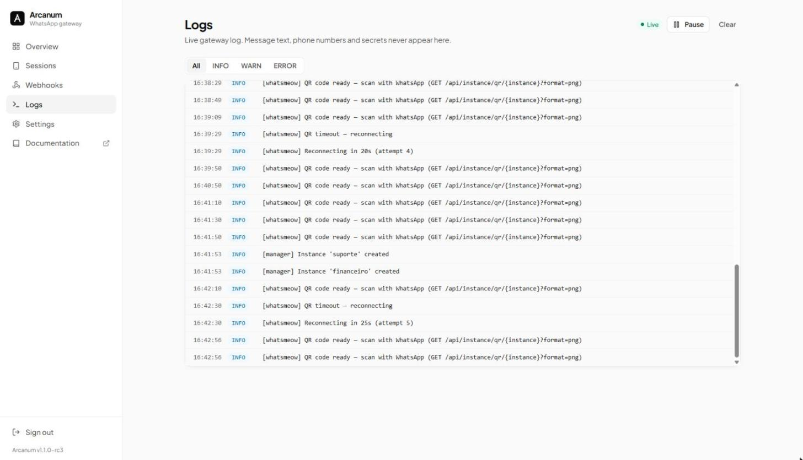
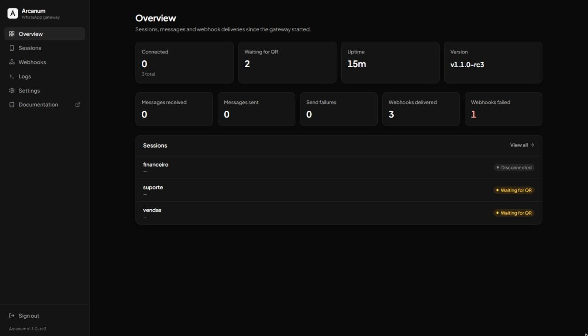

<p align="center">
  
</p>

<h1 align="center">Arcanum</h1>

<p align="center">
  <strong>Gateway de WhatsApp open source e auto-hospedado, em Go.</strong><br>
  Várias sessões, anti-ban nativo, webhooks assinados e painel web. Um único binário, sem navegador, sem Node.
</p>

<p align="center">
  <a href="https://github.com/rafaeldourado9/arcanum/actions/workflows/ci.yml"></a>
  <a href="https://github.com/rafaeldourado9/arcanum/releases"></a>
  
  <a href="LICENSE"></a>
  <a href="https://arcanumgateway.com.br/"></a>
</p>

<p align="center">
  <a href="README.en.md">English</a> ·
  <a href="https://arcanumgateway.com.br/"><b>Documentação</b></a> ·
  <a href="https://arcanumgateway.com.br/getting-started/">Primeiros passos</a> ·
  <a href="https://arcanumgateway.com.br/tutorials/">Treinamento</a> ·
  <a href="https://arcanumgateway.com.br/webhooks/">Webhooks</a> ·
  <a href="SECURITY.md">Segurança</a>
</p>

---

<p align="center">
  
</p>

<table>
  <tr>
    <td></td>
    <td></td>
  </tr>
  <tr>
    <td></td>
    <td></td>
  </tr>
</table>

## Por que o Arcanum

- **Leve**: um único binário Go sobre a [whatsmeow](https://github.com/tulir/whatsmeow). Sobe em
  milissegundos, usa pouca memória, roda até num Raspberry Pi.
- **Anti-ban nativo**: "digitando..." proporcional ao tamanho da mensagem, pausa humana, limite
  por minuto e uma mensagem por vez em cada conversa, em todo envio.
- **Vários números, uma API**: cada sessão tem seu webhook, suas configurações e seu limite, e
  sobrevive a reinícios.
- **Webhooks confiáveis**: assinatura HMAC-SHA256, formato compatível com a Cloud API da Meta ou
  um formato simples, e o campo `fromMe` para o atendimento humano.
- **Painel incluso**: gerencie sessões, leia QR codes, teste webhooks e acompanhe os logs ao vivo
  pelo navegador, em tema claro e escuro, em português e inglês.
- **Seguro por padrão**: chave de API em toda rota, painel com senha, webhooks protegidos contra
  SSRF, nenhum dado pessoal no log, imagem distroless sem root, varredura de vulnerabilidades no CI.
- **Instala em qualquer lugar**: `npx`, Docker, script de uma linha, systemd, Kubernetes ou um
  binário para Linux, macOS e Windows.

## Instalação

| | Comando |
|---|---|
| **Agente de IA** (Claude Code, Cursor, Copilot...) | Cole o prompt de [Instalar com um agente](#instalar-com-um-agente-de-ia) |
| **Windows** (PowerShell) | `irm https://arcanumgateway.com.br/install.ps1 \| iex` |
| **npx** (Node.js 18+ e Git) | `npx github:rafaeldourado9/arcanum` |
| **Projeto novo** (Compose + chaves geradas) | `npx github:rafaeldourado9/arcanum init` |
| **Docker** | `docker run -p 3100:3100 -v arcanum-data:/data ghcr.io/rafaeldourado9/arcanum` |
| **Script Linux / macOS** | `curl -fsSL https://arcanumgateway.com.br/install.sh \| sh` |
| **Serviço do systemd** | `curl -fsSL https://arcanumgateway.com.br/install.sh \| sh -s -- --systemd` |
| **Binário** (Linux, macOS, Windows) | [Releases](https://github.com/rafaeldourado9/arcanum/releases) |

No Windows, o instalador do PowerShell funciona mesmo com scripts bloqueados e não pede
administrador. O `npx` precisa do **Git** instalado; no PowerShell, digite `npx.cmd` no lugar de
`npx`. No Linux sem sudo, instale na sua pasta:
`curl -fsSL https://arcanumgateway.com.br/install.sh | ARCANUM_BIN_DIR="$HOME/.local/bin" sh`.

Todos os instaladores baixam a versão publicada nas Releases e conferem o SHA-256 antes de
instalar. Testados em Ubuntu 24.04, Alpine, Node.js 22 e Windows 11.

Depois abra **http://localhost:3100**. Detalhes: [Instalação](https://arcanumgateway.com.br/installation/).

## Instalar com um agente de IA

Copie e cole no seu agente favorito (Claude Code, Cursor, Copilot, Codex, Gemini CLI):

```text
Instale o Arcanum, gateway de WhatsApp open source, nesta máquina seguindo as instruções oficiais em https://arcanumgateway.com.br/agent.txt. Me pergunte antes de instalar como serviço do sistema, abrir portas ou expor algo na internet. No fim, me diga como iniciar e parar, onde ficaram as chaves e como conectar meu primeiro número.
```

O agente segue as instruções oficiais de [agent.txt](https://arcanumgateway.com.br/agent.txt):
só fontes oficiais, SHA-256 conferido, porta 3100 fora da internet e pergunta antes de mexer no
sistema.

## Começo rápido

```bash
export ARCANUM_KEY="$(openssl rand -hex 32)"

docker run -d --name arcanum -p 3100:3100 \
  -e GATEWAY_API_KEY="$ARCANUM_KEY" \
  -e GATEWAY_DASHBOARD_PASSWORD="escolha-uma-senha-longa" \
  -v arcanum-data:/data \
  ghcr.io/rafaeldourado9/arcanum:latest

# abra http://localhost:3100 para o painel, ou use a API:
# crie uma sessão e pegue o QR code
curl -X POST localhost:3100/api/instance/create \
  -H "X-Api-Key: $ARCANUM_KEY" -H "Content-Type: application/json" \
  -d '{"instanceName": "vendas"}'
curl -H "X-Api-Key: $ARCANUM_KEY" "localhost:3100/api/instance/connect/vendas?format=png" -o qr.png

# depois de ler o qr.png em WhatsApp > Aparelhos conectados:
curl -X POST localhost:3100/api/message/sendText/vendas \
  -H "X-Api-Key: $ARCANUM_KEY" -H "Content-Type: application/json" \
  -d '{"number": "5511999999999", "text": "Olá, aqui é o Arcanum!"}'
```

Abra **http://localhost:3100** para o painel, ou **/docs** para a API interativa.

Tem Node.js? **`npx github:rafaeldourado9/arcanum`** roda o gateway sem Docker e sem instalar nada, e
**`npx github:rafaeldourado9/arcanum init`** cria um projeto Compose com as chaves já geradas.

Sem Docker nem Node? `curl -fsSL https://arcanumgateway.com.br/install.sh | sh` (acrescente
`-s -- --systemd` para instalar como serviço), ou baixe um binário para Linux, macOS ou Windows
nas [Releases](https://github.com/rafaeldourado9/arcanum/releases). Todas as opções:
[Instalação](https://arcanumgateway.com.br/installation/).

**Aprenda fazendo:** quatro aulas curtas de [treinamento](https://arcanumgateway.com.br/tutorials/)
montam um bot de verdade a partir do projeto pronto em [`examples/faq-bot`](examples/faq-bot):
respostas automáticas, atendimento humano, avisos pelo seu sistema e troca de servidor.

O guia completo (sessões, todos os tipos de mensagem, formatos do webhook com verificação de
assinatura em Python, Node.js, Go e PHP, produção com HTTPS, monitoramento e problemas comuns)
está em **[arcanumgateway.com.br](https://arcanumgateway.com.br/)** (em inglês em
[/en](https://arcanumgateway.com.br/en/)). As mesmas
páginas ficam em [`docs/pt/`](docs/pt/) neste repositório.

## Recursos

| | |
|---|---|
| Sessões | QR code (JSON ou PNG) ou código de pareamento, reconexão automática, persistem entre reinícios |
| Mensagens | Texto, imagem, áudio, vídeo, documento, localização, contato, reação, enquete |
| Conversa | Confirmação de leitura, consulta de número, nome, recado e foto do perfil |
| Webhooks | Formato `simple` ou `meta`, assinatura HMAC, eventos de digitação e de falha de envio, `fromMe` |
| Painel | Sessões e QR codes, teste e histórico de webhooks, exportar/importar, logs ao vivo |
| Operação | `/health`, `/metrics` do Prometheus, logs em JSON, desligamento limpo, checagem de saúde |
| Segurança | Chave de API, proteção contra SSRF, limite de pedidos, cabeçalhos de segurança, imagem sem root |

No roadmap: filtro por evento e reenvio de webhooks, armazenamento de mensagens
(`findChats`, `findMessages`), grupos e SDKs oficiais para Python, Node.js e Go.

## Configuração

Tudo é configurado por variáveis de ambiente. O essencial:

| Variável | Padrão | |
|---|---|---|
| `GATEWAY_API_KEY` | gerada | Chave obrigatória. Use `openssl rand -hex 32`. |
| `GATEWAY_WEBHOOK_FORWARD_URL` | | Webhook de todas as sessões (`{instance}` é trocado pelo nome). |
| `GATEWAY_META_APP_SECRET` | | Segredo do HMAC que assina os webhooks. |
| `GATEWAY_WEBHOOK_FORMAT` | `simple` | `simple` ou `meta`. |
| `GATEWAY_DASHBOARD_PASSWORD` | | Senha do painel (sem ela, o login usa a chave de API). |

Veja o [`.env.example`](.env.example) (binário) ou o [`deploy/.env.example`](deploy/.env.example) (Docker Compose) e a
[referência de configuração](https://arcanumgateway.com.br/configuration/).

## Desenvolvimento

```bash
go test ./...                         # Go 1.26+, sem compilador C (SQLite em Go puro)
(cd web && npm ci && npm run build)   # painel, embutido no binário
go run ./cmd/gateway
```

Sem Go instalado? Rode os testes no Docker:

```bash
docker run --rm -v "$PWD":/src -w /src golang:1.26-alpine go test ./...
```

Prévia da documentação: `pip install -r requirements-docs.txt && mkdocs serve`.

Contribuições são bem-vindas: veja o [CONTRIBUTING.md](CONTRIBUTING.md). Falhas de segurança
devem ser reportadas em privado, como explica o [SECURITY.md](SECURITY.md).

## Aviso

O Arcanum não tem vínculo, aprovação ou ligação com o WhatsApp ou a Meta. Ele usa o mesmo
protocolo do WhatsApp Web. Mensagens automáticas podem levar ao banimento do número: siga os
[termos do WhatsApp](https://www.whatsapp.com/legal/terms-of-service) e fale só com quem espera
o seu contato.

## Licença

[MIT](LICENSE)
