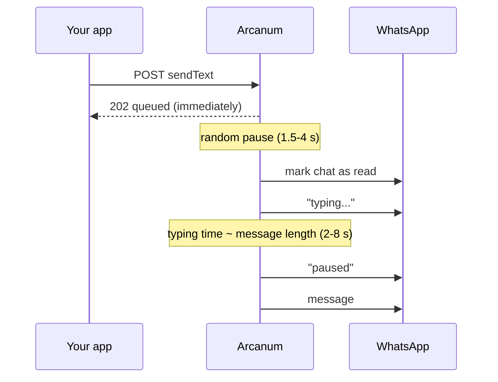

# Anti-ban

WhatsApp watches for accounts that behave like machines: instant replies, bursts of
identical messages, no typing. Arcanum makes every text send look like a person wrote it.

## What happens on each text

1. **Per-minute limit.** Each session sends at most `GATEWAY_RATE_LIMIT_PER_MIN` messages
   per rolling minute (15 by default). Over the limit, the API answers `429`.
2. **Human pause** between `GATEWAY_MIN_DELAY_MS` and `GATEWAY_MAX_DELAY_MS`.
3. **Read, then type.** The chat is marked as read and "typing..." is shown for a time
   proportional to the message (`GATEWAY_MS_PER_CHAR`), never shorter than
   `GATEWAY_TYPING_DURATION_MS` nor longer than `GATEWAY_MAX_TYPING_MS`, plus up to one
   second of jitter.
4. **One at a time per chat.** A reply split in several messages arrives in order.
5. **Retries** for transient errors (3 attempts with backoff). Permanent errors (number not
   on WhatsApp, forbidden) are not retried.

Audio messages show "recording audio..." instead of "typing...".

## Tuning

| Variable | Default | |
|---|---|---|
| `GATEWAY_RATE_LIMIT_PER_MIN` | `15` | Messages per minute per session. |
| `GATEWAY_MIN_DELAY_MS` | `1500` | Shortest pause before typing. |
| `GATEWAY_MAX_DELAY_MS` | `4000` | Longest pause before typing. |
| `GATEWAY_TYPING_DURATION_MS` | `2000` | Shortest typing time. |
| `GATEWAY_MS_PER_CHAR` | `50` | Typing time per character. |
| `GATEWAY_MAX_TYPING_MS` | `8000` | Longest typing time. |

Lower values send faster and look less human. The defaults are a safe starting point for
customer service; raise them for cold outreach.

## Good practices

The best protection is behaviour, not code:

- **Warm up new numbers.** Use a fresh number by hand for a few days before automating it,
  and grow the volume slowly.
- **Message people who expect it.** Most bans start with users reporting spam.
- **Vary the text.** Hundreds of identical messages are an easy signal.
- **Give a way out.** "Reply STOP to stop receiving messages" and honour it.
- **Prefer replies over cold messages.** Conversations started by the customer are far
  safer.

!!! warning
    No tool can guarantee a number will not be banned. Arcanum reduces the risk; how you use
    it decides the rest.
