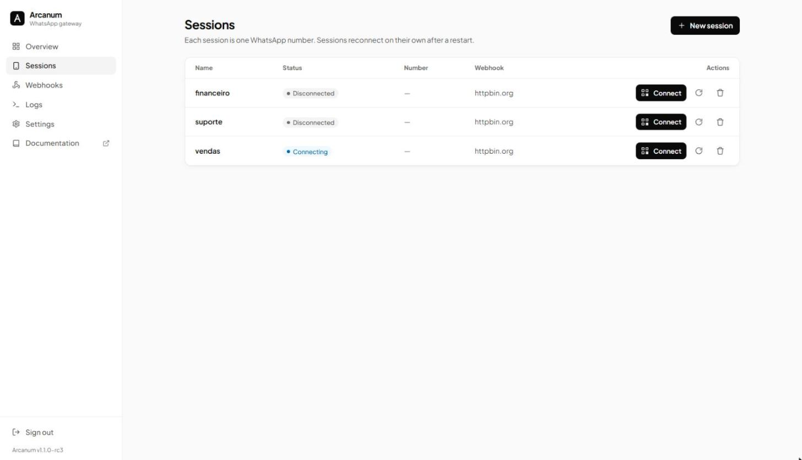
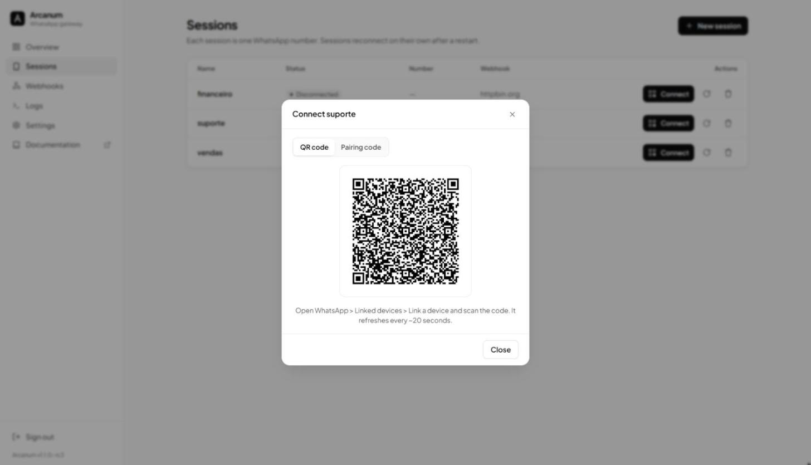
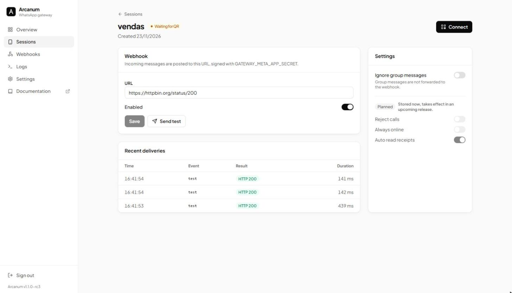
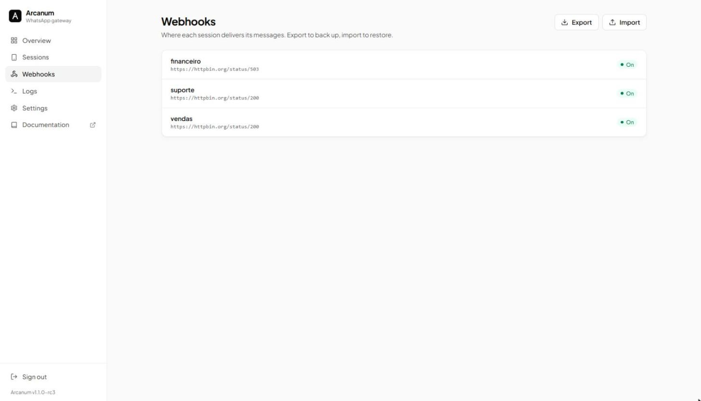
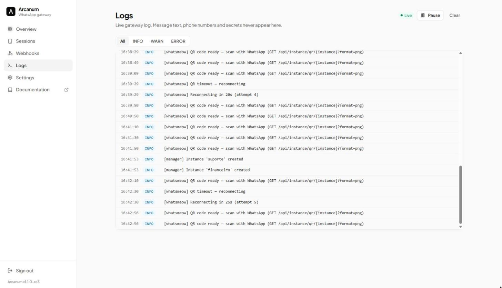
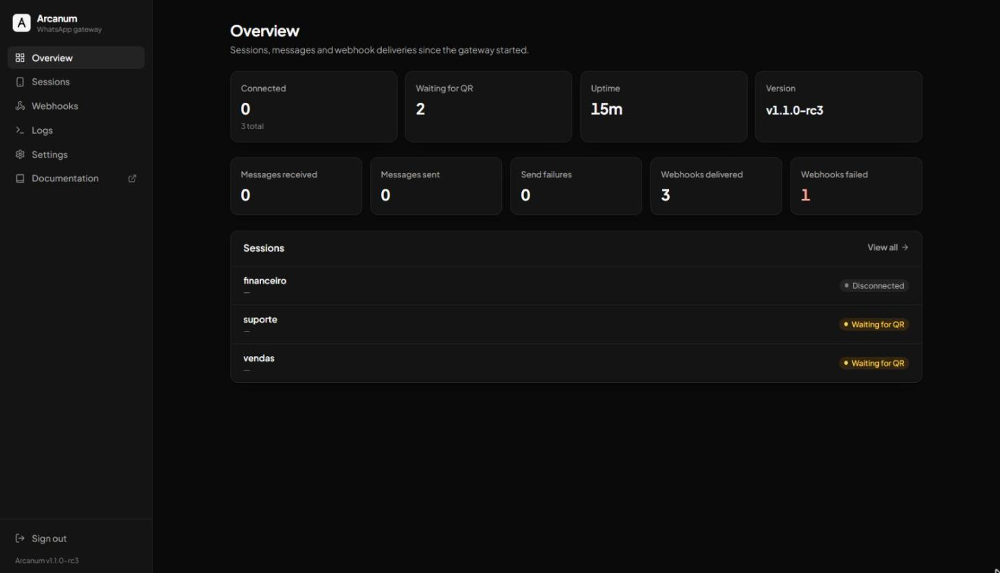
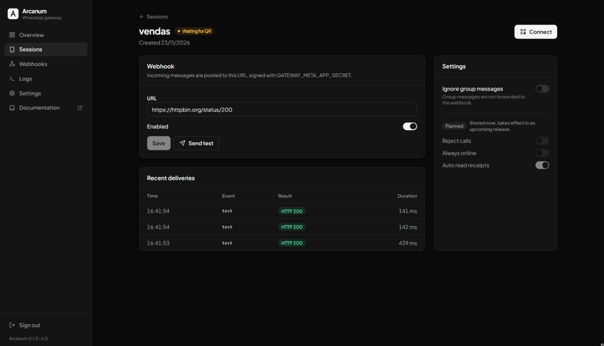
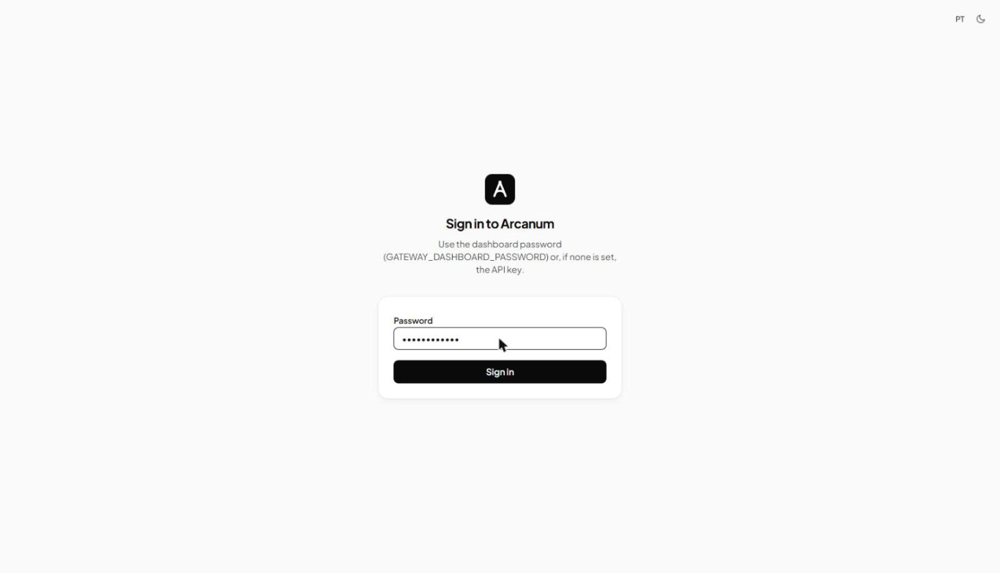

# Dashboard

Arcanum ships a web dashboard inside the same binary. Open the gateway address in a browser
(`http://localhost:3100`) and sign in.


## Signing in

| Setting | Password to use |
|---|---|
| `GATEWAY_DASHBOARD_PASSWORD` set | That password. **Recommended**: you never paste the API key in a browser. |
| Not set | The API key (`GATEWAY_API_KEY`). |
| `GATEWAY_DASHBOARD=false` | The dashboard is turned off; `/` returns 404. |

Sessions last 12 hours and end when the gateway restarts. After 10 wrong passwords from the
same address in 15 minutes, sign-in is locked for that address.

## What you can do

**Overview**
:   Connected sessions, sessions waiting for a QR code, messages received and sent, webhook
    deliveries and failures, uptime and version. Refreshes every few seconds.

**Sessions**
:   Create a session, show its QR code (it refreshes by itself until the phone scans it) or a
    pairing code, see status and number, restart, disconnect or delete. Deleting unlinks the
    device from the phone and removes the session files.

**Session page**
:   Webhook URL and on/off switch, **Send test** (a signed `{"event":"test"}` delivery with
    the HTTP status and time), the last 100 deliveries with status and duration, and
    per-session settings.

**Webhooks**
:   Every session's webhook at a glance. **Export** downloads a JSON file with all of them;
    **Import** applies such a file to the sessions that exist (handy when moving servers).

**Logs**
:   The gateway log, live, filterable by level, with pause. Message text, phone numbers and
    secrets (API key, passwords) never appear.

**Settings**
:   Light or dark theme, English or Portuguese, links to the API and this guide.

## Screens

=== "Sessions"

    

=== "Connect (QR code)"

    

=== "Session page"

    

=== "Webhooks"

    

=== "Logs"

    

=== "Dark theme"

    

    

=== "Sign in"

    

## How it is protected

- The session cookie is `HttpOnly` (scripts cannot read it), `SameSite=Strict` (other sites
  cannot use it) and `Secure` over HTTPS.
- Every dashboard request also carries an anti-CSRF header; a cookie alone is refused.
- The page only loads code from the gateway itself (strict Content Security Policy) and
  cannot be embedded in another site.
- Sessions are kept in memory as hashes: nothing to steal from disk.

!!! warning "Use HTTPS"
    Over plain HTTP the password travels in clear text. On anything but `localhost`, put
    Arcanum behind a reverse proxy with HTTPS ([Deployment](deployment.md)).

## Developing the dashboard

The source is in `web/` (React, TypeScript, Vite, Tailwind CSS):

```bash
cd web
npm ci
npm run dev        # http://localhost:5180, proxies the API to a gateway on :3100
npm run build      # outputs to internal/dashboard/dist, embedded by `go build`
```
