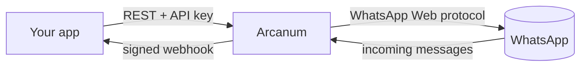

---
hide:
  - navigation
  - toc
---

<div class="arcanum-hero" markdown>

# WhatsApp API you host yourself

Arcanum is an open-source WhatsApp gateway written in Go. One small binary connects your
WhatsApp numbers and gives you a REST API, signed webhooks and an anti-ban layer that
behaves like a person typing. No browser, no Node, no vendor lock-in.

[Get started in 5 minutes](getting-started.md){ .md-button .md-button--primary }
[GitHub](https://github.com/rafaeldourado9/arcanum){ .md-button }

</div>

```bash
docker run -d --name arcanum -p 3100:3100 \
  -e GATEWAY_API_KEY="$(openssl rand -hex 32)" \
  -v arcanum-data:/data \
  ghcr.io/rafaeldourado9/arcanum:latest
```

<div class="grid cards" markdown>

-   **Light and fast**

    A single Go binary built on [whatsmeow](https://github.com/tulir/whatsmeow). Tens of
    megabytes of RAM per session, starts in milliseconds, runs on a Raspberry Pi.

-   **Anti-ban built in**

    Typing indicator sized to the message, human-like random delay, per-minute limit and
    one message at a time per chat. On by default for every send.

-   **Many numbers, one API**

    Create as many sessions as you need. Each one has its own webhook, settings and
    rate limit. Sessions survive restarts.

-   **Webhooks you can trust**

    HMAC-SHA256 signature on every delivery, Meta Cloud API compatible format or a simple
    flat format, and a `fromMe` flag so your bot knows when a human took over.

-   **Secure by default**

    API key on every route, input validation, SSRF protection on webhooks, no personal
    data in logs, non-root container, vulnerability scans in CI.

-   **Open source, MIT**

    Read every line, fork it, run it anywhere. No license keys, no phone-home.

</div>

## The dashboard

Manage sessions, scan QR codes, test webhooks and follow the logs from the browser.
[More about the dashboard](dashboard.md).


## Learn by doing

Four short [tutorials](tutorials/index.md) take you from zero to a bot that answers on its
own, hands over to your team and survives a server move. The code is in
[`examples/faq-bot`](https://github.com/rafaeldourado9/arcanum/tree/main/examples/faq-bot).

## How it fits



Your application calls Arcanum to send messages. Arcanum keeps the WhatsApp sessions
connected and posts every incoming message to your webhook.

## Next steps

- [Getting started](getting-started.md): run it, scan the QR code, send your first message.
- [Webhooks](webhooks.md): receive messages and verify the signature.
- [Deployment](deployment.md): put it in production behind HTTPS.

!!! warning "Not an official API"
    Arcanum talks to WhatsApp through the same protocol as WhatsApp Web. It is not
    affiliated with WhatsApp or Meta. Automated messaging can get numbers banned: respect
    [WhatsApp's terms](https://www.whatsapp.com/legal/terms-of-service), message only
    people who expect to hear from you, and keep the anti-ban layer on.
