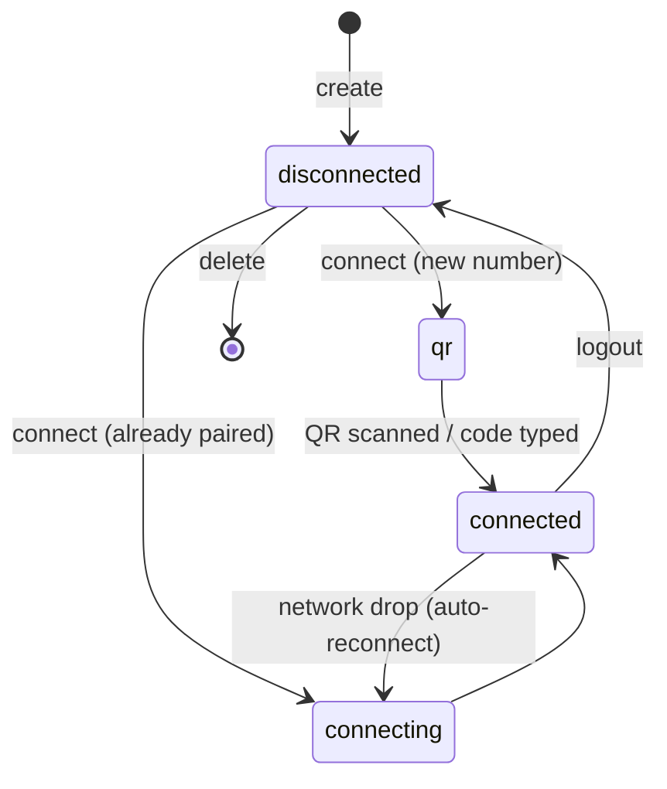

# Sessions

A **session** (or *instance*) is one WhatsApp number connected to Arcanum. You can run as
many as your machine handles; each has its own webhook, settings and rate limit.

## Lifecycle



| Status | Meaning |
|---|---|
| `disconnected` | Not connected. Call `connect`. |
| `qr` | Waiting for the QR code to be scanned (or the pairing code to be typed). |
| `connecting` | Opening the connection or reconnecting after a drop. |
| `connected` | Ready to send and receive. |

Paired sessions are stored on disk (`GATEWAY_DB_PATH`: `<name>.db` for the WhatsApp session,
`<name>.json` for its webhook and settings) and **reconnect automatically when Arcanum
restarts**, with the same configuration. Network drops are retried forever with
a backoff of up to 30 seconds.

## Create

```bash
curl -X POST http://localhost:3100/api/instance/create \
  -H "X-Api-Key: $ARCANUM_KEY" -H "Content-Type: application/json" \
  -d '{
        "instanceName": "sales",
        "webhook": "https://your-app.example.com/webhooks/whatsapp/sales"
      }'
```

| Field | Required | Notes |
|---|---|---|
| `instanceName` | yes | 1-64 characters: `A-Z a-z 0-9 - _`. It becomes a file name, so nothing else is accepted. |
| `webhook` | no | Webhook URL for this session. Without it, `GATEWAY_WEBHOOK_FORWARD_URL` is used. |
| `webhookEvents` | no | Defaults to `["messages", "status"]`. |

Answers `201` with the session, `409` if the name exists, `400` if the name or the webhook
URL is invalid.

## Connect

=== "QR code (JSON)"

    ```bash
    curl -H "X-Api-Key: $ARCANUM_KEY" http://localhost:3100/api/instance/connect/sales
    ```

    ```json
    {
      "instanceName": "sales",
      "status": "qr",
      "qr": "data:image/png;base64,iVBORw0KGgo..."
    }
    ```

    The `qr` field drops straight into an HTML image: ``.

=== "QR code (PNG)"

    ```bash
    curl -H "X-Api-Key: $ARCANUM_KEY" \
      "http://localhost:3100/api/instance/connect/sales?format=png" -o qr.png
    ```

=== "Pairing code"

    ```bash
    curl -X POST http://localhost:3100/api/instance/pair/sales \
      -H "X-Api-Key: $ARCANUM_KEY" -H "Content-Type: application/json" \
      -d '{"phone": "5511999999999"}'
    ```

    Type the returned `code` in WhatsApp: **Linked devices > Link a device > Link with
    phone number instead**.

The QR code rotates every ~20 seconds; poll `connectionState` (or `qr`) to show the latest
one. Calling `connect` again while waiting returns the current QR code: it never opens a
second connection.

## Inspect

```bash
# One session
curl -H "X-Api-Key: $ARCANUM_KEY" http://localhost:3100/api/instance/connectionState/sales

# All sessions, with settings and webhook configuration
curl -H "X-Api-Key: $ARCANUM_KEY" http://localhost:3100/api/instance/fetchInstances
```

## Restart, disconnect, delete

| Action | Route | Effect |
|---|---|---|
| Restart | `POST /api/instance/restart/{name}` | Reconnects. Nothing to scan. |
| Disconnect | `DELETE /api/instance/logout/{name}` | Drops the connection; the session stays paired. |
| Delete | `DELETE /api/instance/delete/{name}` | Unlinks the device from the phone, closes the session and removes its files. It does not come back after a restart. |

!!! note "Unlinking from the phone"
    If you remove the device in **WhatsApp > Linked devices**, the session becomes invalid
    and needs a new QR code. Delete it in Arcanum and create it again.

## Settings

```bash
curl -X POST http://localhost:3100/api/settings/sales \
  -H "X-Api-Key: $ARCANUM_KEY" -H "Content-Type: application/json" \
  -d '{"groupsIgnore": true}'
```

| Setting | Status | Effect |
|---|---|---|
| `groupsIgnore` | available | Group messages are not forwarded to the webhook. |
| `rejectCalls` | planned | Stored, no effect yet. |
| `alwaysOnline` | planned | Stored, no effect yet. |
| `readMessages` | planned | Stored, no effect yet. |
| `readStatus` | planned | Stored, no effect yet. |
| `syncFullHistory` | planned | Stored, no effect yet. |

Group, status (stories), broadcast and channel messages are never forwarded today: Arcanum
focuses on one-to-one conversations.
