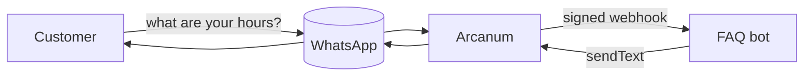
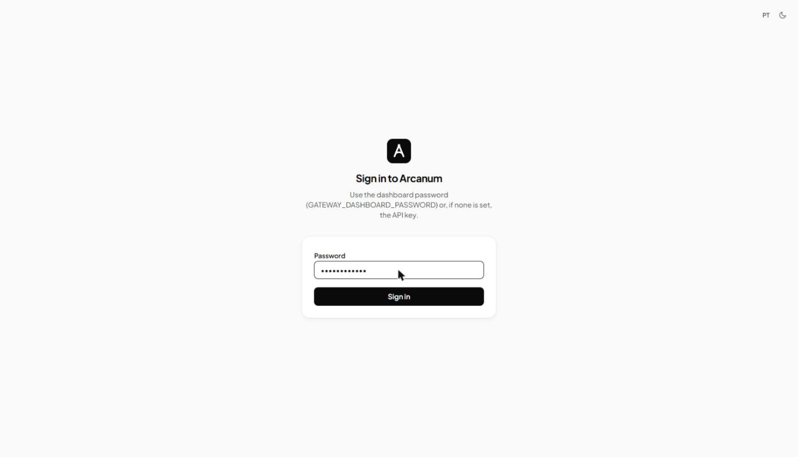
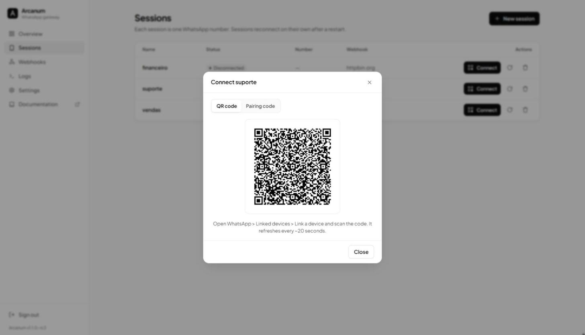
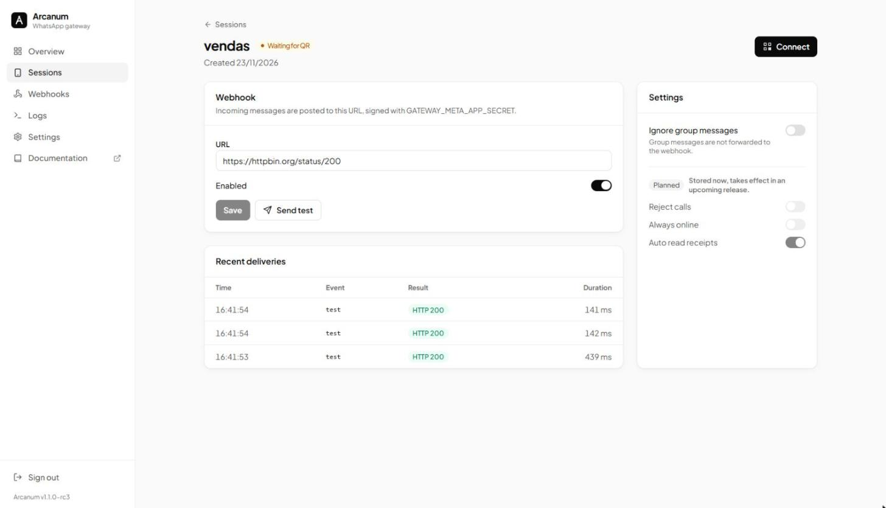
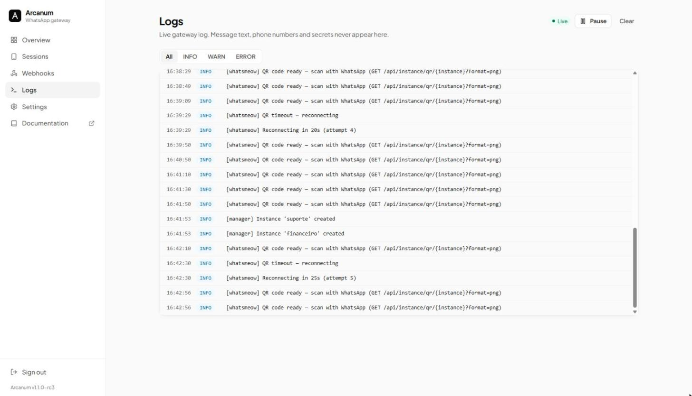

# Tutorial 1: your first bot

By the end you will have a WhatsApp number answering common questions by itself, running on
your machine with Arcanum and about 100 lines of Python.



## 1. Get the project

```bash
git clone https://github.com/rafaeldourado9/arcanum.git
cd arcanum/examples/faq-bot
cp .env.example .env
```

Fill the three values in `.env`, each with its own random string:

```bash
openssl rand -hex 32   # run three times
```

| Variable | What it is |
|---|---|
| `ARCANUM_KEY` | API key: the bot uses it to send messages. |
| `ARCANUM_WEBHOOK_SECRET` | Signs every webhook; the bot rejects anything not signed with it. |
| `DASHBOARD_PASSWORD` | Your password for the dashboard. |

## 2. Start everything

```bash
docker compose up -d --build
```

Two containers start: `arcanum` and `bot`. Arcanum is already configured to deliver every
session's messages to the bot (`GATEWAY_WEBHOOK_FORWARD_URL` in `compose.yaml`).

## 3. Connect the number

Open **http://localhost:3100** and sign in with `DASHBOARD_PASSWORD`.



Go to **Sessions > New session**, call it `demo` and click **Create**. The QR code opens
right away:



On the bot phone: **WhatsApp > Linked devices > Link a device**, and scan. The status turns
**Connected**.

!!! tip "No camera?"
    Use the **Pairing code** tab: type the number with country code and enter the 8-character
    code in WhatsApp > Linked devices > Link with phone number.

## 4. Check the webhook

Open the session `demo` and click **Send test**. You should see `Delivered: HTTP 200`, and
the delivery appears in **Recent deliveries**:



If you see `HTTP 401`, the bot and Arcanum have different `ARCANUM_WEBHOOK_SECRET` values.

## 5. Talk to it

From another phone, send the bot number: **"what are your opening hours?"**. A few seconds
later (typing indicator, human pause: that is the [anti-ban](../anti-ban.md) layer) it
answers with the hours from `faq.json`.

Try "how much?", "where are you?" or anything else to see the fallback answer.

## 6. Understand the code

The whole bot is [`app.py`](https://github.com/rafaeldourado9/arcanum/blob/main/examples/faq-bot/app.py).
The important parts:

```python
body = await request.body()
if not verify_signature(body, x_hub_signature_256):   # 1. only Arcanum can call us
    raise HTTPException(status_code=401)

event = json.loads(body)
if event.get("from_me"):                               # 2. a human answered: step aside
    paused_until[chat] = time.time() + HUMAN_PAUSE_SECONDS
    return {"ok": True}

background.add_task(reply, instance, chat, answer_for(event["text"]))  # 3. answer later
return {"ok": True}                                    # 4. ...but acknowledge now
```

1. The signature is an HMAC-SHA256 of the raw body with the shared secret.
2. `from_me` is covered in [Tutorial 2](human-takeover.md).
3. `reply` calls `POST /api/message/sendText/{instance}` with the API key.
4. Answering the webhook fast matters: Arcanum waits at most 30 seconds.

## 7. Make it yours

- Edit `faq.json` and run `docker compose restart bot`.
- Swap `answer_for` for a call to an AI model; the structure stays the same.
- Watch what happens in **Logs** while you test:



**Next:** [Tutorial 2: human takeover](human-takeover.md).
