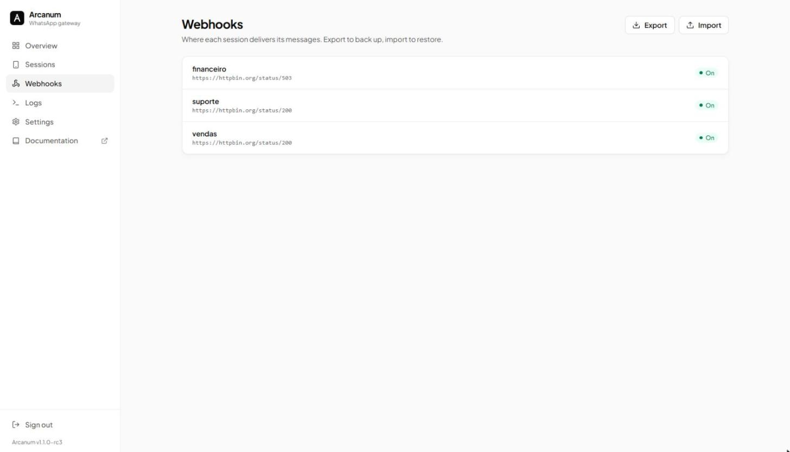

# Tutorial 4: move to a new server

Changing servers should not mean asking every customer number to scan a QR code again. The
WhatsApp sessions are files: copy them and they come back logged in.

## What lives where

| Item | Where | Carries |
|---|---|---|
| `<name>.db` | data volume | The logged-in WhatsApp session (keys). |
| `<name>.json` | data volume | Webhook and settings of the session. |
| Environment | `.env` / compose | API key, dashboard password, webhook secret. |

## 1. On the old server: back up

```bash
docker compose stop arcanum          # a clean copy needs the gateway stopped
docker run --rm -v arcanum-data:/data -v "$PWD":/backup alpine \
  tar czf /backup/arcanum-data.tgz -C /data .
docker compose start arcanum         # back online while you move
```

Also keep a copy of the webhook configuration, handy as a readable record:

```bash
curl -H "X-Api-Key: $ARCANUM_KEY" http://localhost:3100/api/events/webhooks/export -o webhooks.json
```

Or in the dashboard: **Webhooks > Export**.



!!! danger "The archive is a set of logged-in WhatsApp accounts"
    Encrypt it before copying (`age -p arcanum-data.tgz > arcanum-data.tgz.age`) and delete
    it from both machines when you are done.

## 2. On the new server: restore

```bash
# same compose.yaml and .env as before
docker volume create arcanum-data
docker run --rm -v arcanum-data:/data -v "$PWD":/backup alpine \
  sh -c "tar xzf /backup/arcanum-data.tgz -C /data && chown -R 65532:65532 /data"
docker compose up -d
```

## 3. Switch over

1. Stop Arcanum on the old server **for good** (`docker compose down`). The same session must
   never run on two servers at once: WhatsApp disconnects both.
2. Point your DNS (or your application's `ARCANUM_URL`) to the new server.
3. Open the dashboard: sessions show **Connected** within a few seconds, with the same
   webhooks.


## Only moving the webhooks?

If you recreate the sessions (new QR codes) but want the same webhook setup, import the file
you exported: **Webhooks > Import**, or

```bash
curl -X POST -H "X-Api-Key: $ARCANUM_KEY" -H "Content-Type: application/json" \
  --data @webhooks.json http://NEW-SERVER:3100/api/events/webhooks/import
```

Sessions that do not exist yet are listed as `skipped`.

You finished the tutorials. The [API reference](../api-reference.md) and the
interactive docs at `/docs` cover everything else.
