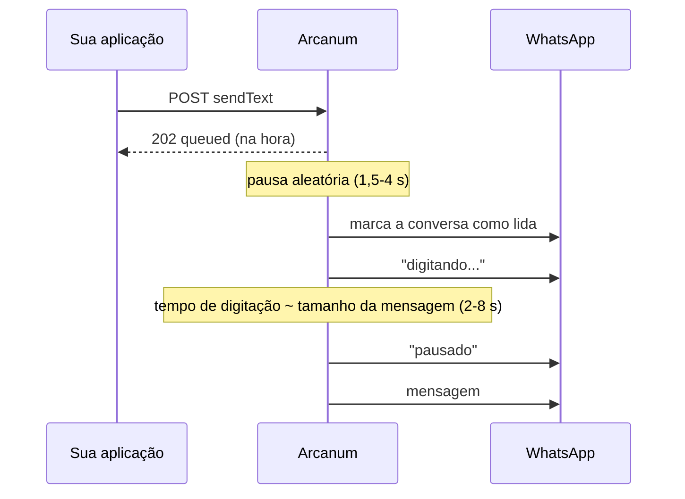

# Anti-ban

O WhatsApp fica de olho em contas que agem como máquina: resposta instantânea, rajadas de
mensagens iguais, nada de "digitando...". O Arcanum faz cada envio de texto parecer escrito
por uma pessoa.

## O que acontece em cada texto

1. **Limite por minuto.** Cada sessão envia no máximo `GATEWAY_RATE_LIMIT_PER_MIN`
   mensagens por minuto, em janela móvel (15 por padrão). Acima disso, a API responde `429`.
2. **Pausa humana** entre `GATEWAY_MIN_DELAY_MS` e `GATEWAY_MAX_DELAY_MS`.
3. **Lê, depois digita.** A conversa é marcada como lida e o "digitando..." aparece por um
   tempo proporcional à mensagem (`GATEWAY_MS_PER_CHAR`), nunca menor que
   `GATEWAY_TYPING_DURATION_MS` nem maior que `GATEWAY_MAX_TYPING_MS`, mais até um segundo
   de variação.
4. **Uma por vez em cada conversa.** Uma resposta dividida em várias mensagens chega na
   ordem.
5. **Novas tentativas** em erros passageiros (3 tentativas, com espera crescente). Erros
   permanentes (número sem WhatsApp, proibido) não são repetidos.

Áudios mostram "gravando áudio..." no lugar de "digitando...".

## Ajustes

| Variável | Padrão | |
|---|---|---|
| `GATEWAY_RATE_LIMIT_PER_MIN` | `15` | Mensagens por minuto por sessão. |
| `GATEWAY_MIN_DELAY_MS` | `1500` | Menor pausa antes de digitar. |
| `GATEWAY_MAX_DELAY_MS` | `4000` | Maior pausa antes de digitar. |
| `GATEWAY_TYPING_DURATION_MS` | `2000` | Menor tempo digitando. |
| `GATEWAY_MS_PER_CHAR` | `50` | Tempo digitando por caractere. |
| `GATEWAY_MAX_TYPING_MS` | `8000` | Maior tempo digitando. |

Valores menores enviam mais rápido e parecem menos humanos. Os padrões são um ponto de
partida seguro para atendimento; aumente para prospecção fria.

## Boas práticas

A melhor proteção é o comportamento, não o código:

- **Aqueça números novos.** Use o número na mão por alguns dias antes de automatizar e
  aumente o volume aos poucos.
- **Fale com quem espera.** A maioria dos banimentos começa com usuários denunciando spam.
- **Varie o texto.** Centenas de mensagens idênticas são um sinal fácil.
- **Dê uma saída.** "Responda SAIR para não receber mais mensagens", e respeite.
- **Prefira responder a puxar conversa.** Conversas iniciadas pelo cliente são muito mais
  seguras.

!!! warning
    Nenhuma ferramenta garante que um número não será banido. O Arcanum reduz o risco; o
    jeito de usar decide o resto.
