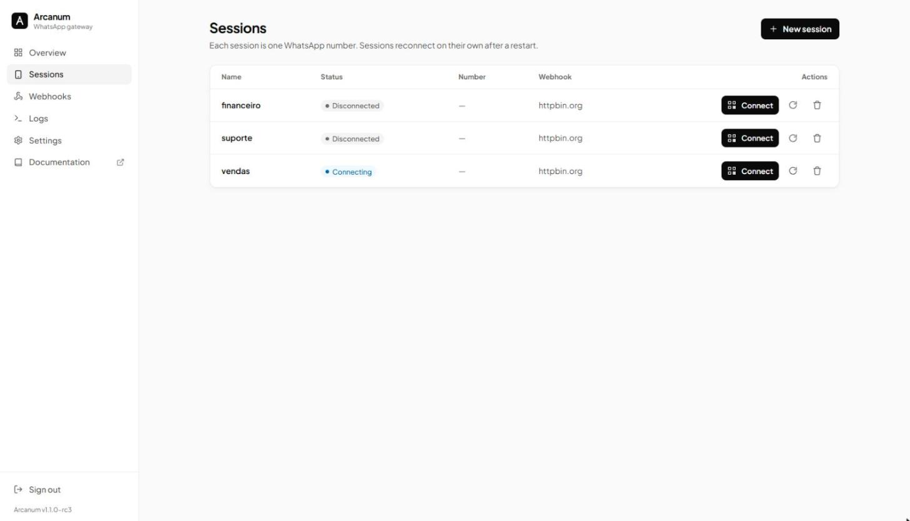
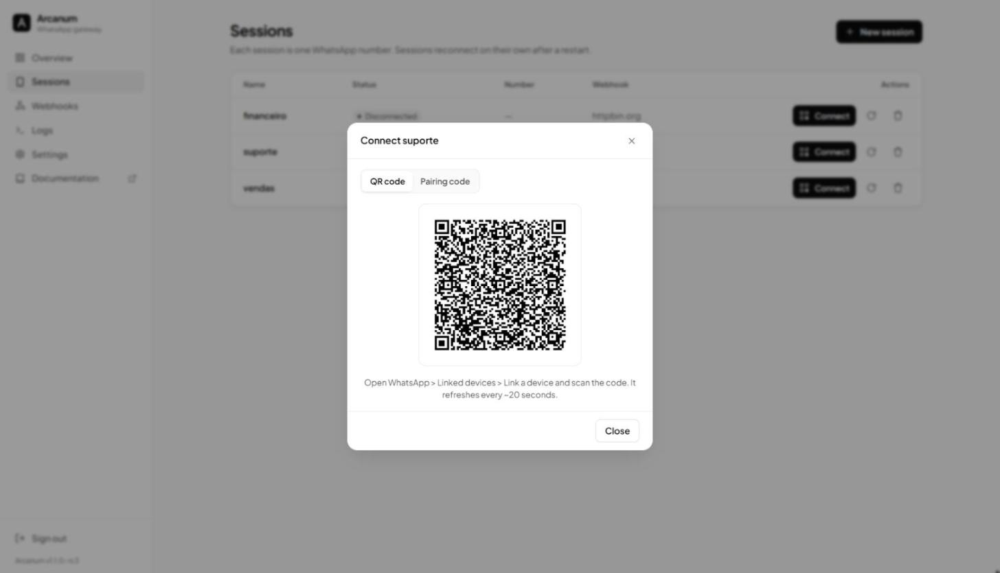
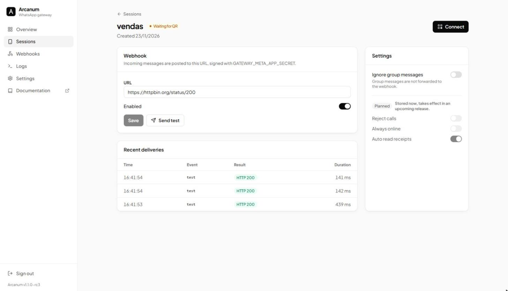
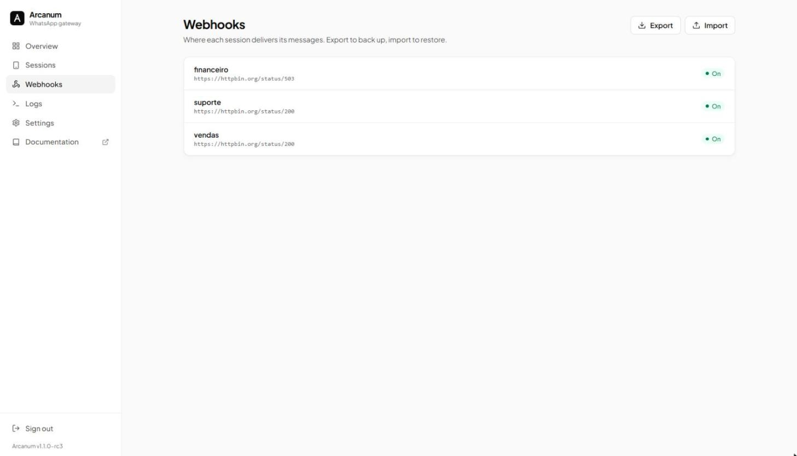
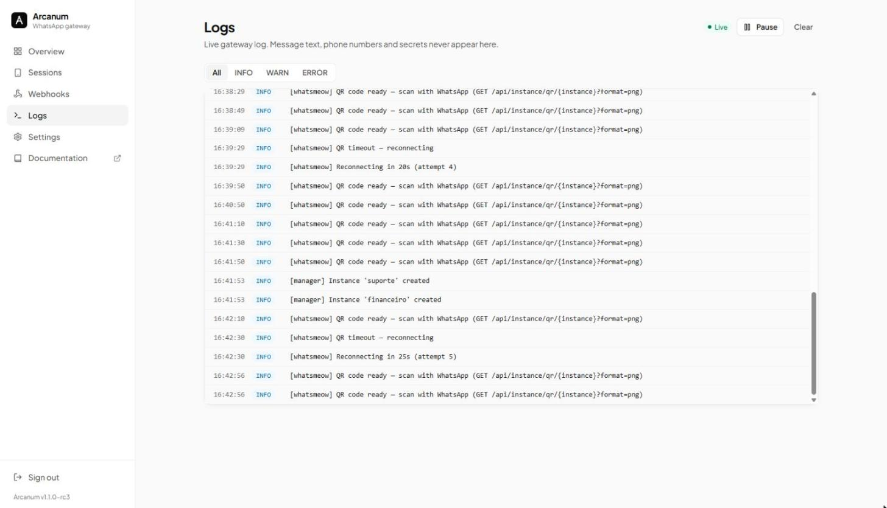
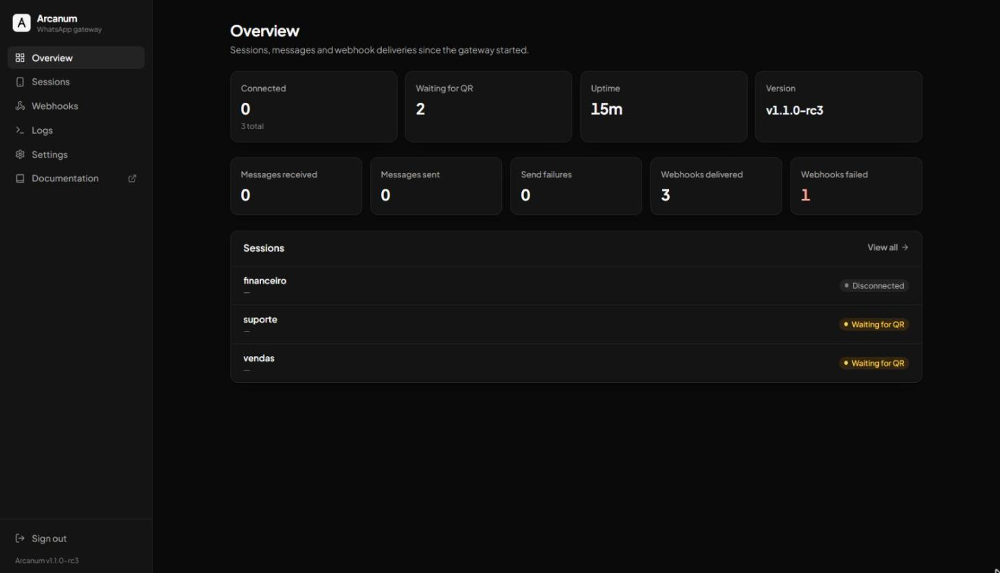
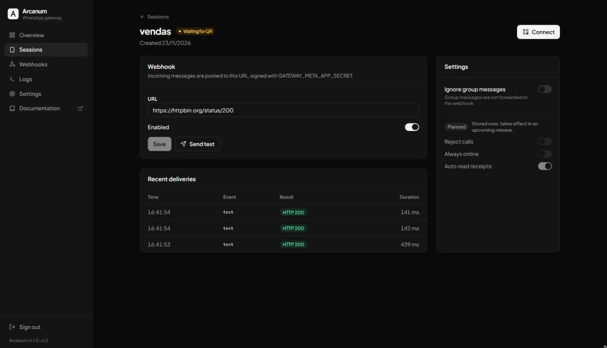
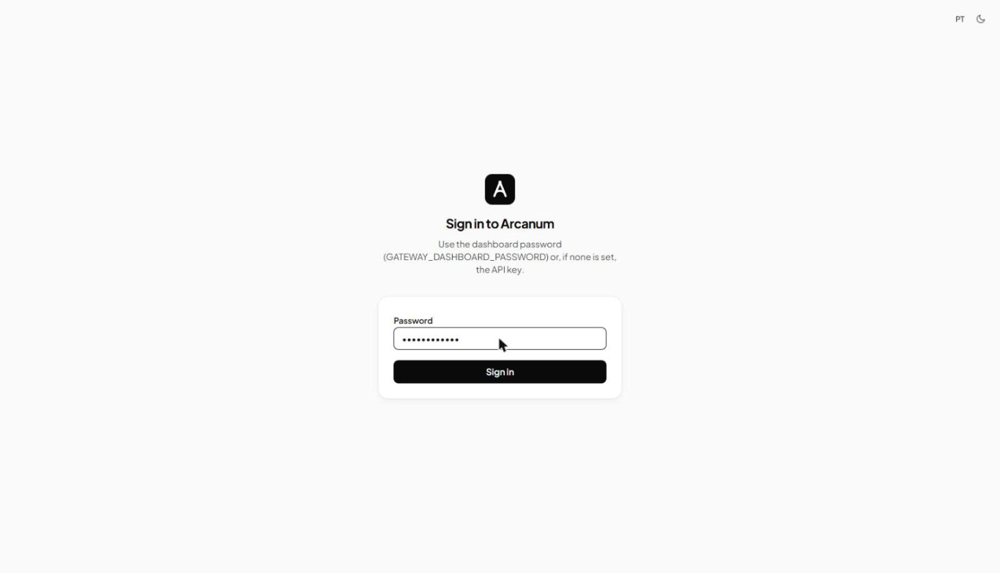

# Painel

O Arcanum traz um painel web dentro do mesmo binário. Abra o endereço do gateway no navegador
(`http://localhost:3100`) e entre.


## Entrando

| Configuração | Senha para usar |
|---|---|
| `GATEWAY_DASHBOARD_PASSWORD` definida | Essa senha. **Recomendado**: você nunca cola a chave de API no navegador. |
| Não definida | A chave de API (`GATEWAY_API_KEY`). |
| `GATEWAY_DASHBOARD=false` | O painel fica desligado; a `/` responde 404. |

A sessão dura 12 horas e termina quando o gateway reinicia. Depois de 10 senhas erradas do
mesmo endereço em 15 minutos, o login fica bloqueado para esse endereço.

## O que dá para fazer

**Visão geral**
:   Sessões conectadas, sessões esperando QR code, mensagens recebidas e enviadas, entregas e
    falhas de webhook, tempo no ar e versão. Atualiza a cada poucos segundos.

**Sessões**
:   Criar uma sessão, mostrar o QR code (ele se atualiza sozinho até o celular ler) ou um código
    de pareamento, ver status e número, reiniciar, desconectar ou apagar. Apagar desconecta o
    aparelho do celular e remove os arquivos da sessão.

**Página da sessão**
:   URL do webhook e chave liga/desliga, **Enviar teste** (uma entrega assinada
    `{"event":"test"}` com o status HTTP e o tempo), as últimas 100 entregas com status e
    duração, e as configurações da sessão.

**Webhooks**
:   O webhook de todas as sessões numa olhada. **Exportar** baixa um JSON com todos;
    **Importar** aplica esse arquivo às sessões que existem (útil ao trocar de servidor).

**Logs**
:   O log do gateway ao vivo, com filtro por nível e pausa. Texto de mensagem, telefones e
    segredos (chave de API, senhas) nunca aparecem.

**Configurações**
:   Tema claro ou escuro, inglês ou português, links para a API e para este guia.

## Telas

=== "Sessões"

    

=== "Conectar (QR code)"

    

=== "Página da sessão"

    

=== "Webhooks"

    

=== "Logs"

    

=== "Tema escuro"

    

    

=== "Login"

    

## Como ele é protegido

- O cookie da sessão é `HttpOnly` (scripts não leem), `SameSite=Strict` (outros sites não usam)
  e `Secure` no HTTPS.
- Todo pedido do painel também leva um cabeçalho anti-CSRF; só o cookie é recusado.
- A página só carrega código do próprio gateway (Content Security Policy restrita) e não pode
  ser embutida em outro site.
- As sessões ficam em memória, guardadas por hash: nada para roubar do disco.

!!! warning "Use HTTPS"
    Em HTTP puro a senha trafega sem criptografia. Fora do `localhost`, coloque o Arcanum atrás
    de um proxy reverso com HTTPS ([Produção](deployment.md)).

## Desenvolvendo o painel

O código fica em `web/` (React, TypeScript, Vite, Tailwind CSS):

```bash
cd web
npm ci
npm run dev        # http://localhost:5180, repassa a API para um gateway na :3100
npm run build      # gera internal/dashboard/dist, embutido pelo `go build`
```
