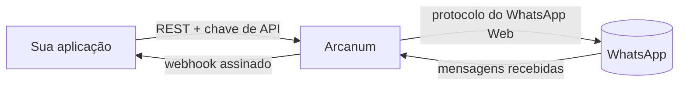

---
hide:
  - navigation
  - toc
---

<div class="arcanum-hero" markdown>

# API de WhatsApp que você mesmo hospeda

O Arcanum é um gateway de WhatsApp open source escrito em Go. Um único binário pequeno
conecta seus números de WhatsApp e entrega uma API REST, webhooks assinados e uma camada
anti-ban que se comporta como uma pessoa digitando. Sem navegador, sem Node, sem ficar
preso a fornecedor.

[Comece em 5 minutos](getting-started.md){ .md-button .md-button--primary }
[GitHub](https://github.com/rafaeldourado9/arcanum){ .md-button }

</div>

```bash
docker run -d --name arcanum -p 3100:3100 \
  -e GATEWAY_API_KEY="$(openssl rand -hex 32)" \
  -v arcanum-data:/data \
  ghcr.io/rafaeldourado9/arcanum:latest
```

<div class="grid cards" markdown>

-   **Leve e rápido**

    Um binário Go sobre a [whatsmeow](https://github.com/tulir/whatsmeow). Poucas dezenas
    de MB de memória por sessão, sobe em milissegundos, roda até num Raspberry Pi.

-   **Anti-ban nativo**

    "Digitando..." proporcional ao tamanho da mensagem, pausa aleatória humana, limite por
    minuto e uma mensagem por vez em cada conversa. Ligado por padrão em todo envio.

-   **Vários números, uma API**

    Crie quantas sessões precisar. Cada uma tem seu webhook, suas configurações e seu
    limite. As sessões sobrevivem a reinícios.

-   **Webhooks confiáveis**

    Assinatura HMAC-SHA256 em toda entrega, formato compatível com a Cloud API da Meta ou um
    formato simples, e o campo `fromMe` para seu bot saber quando um humano assumiu.

-   **Seguro por padrão**

    Chave de API em toda rota, validação de entrada, proteção contra SSRF nos webhooks, nada
    de dado pessoal no log, container sem root e varredura de vulnerabilidades no CI.

-   **Open source, MIT**

    Leia cada linha, faça fork, rode onde quiser. Sem chave de licença, sem telemetria.

</div>

## O painel

Gerencie sessões, leia QR codes, teste webhooks e acompanhe os logs pelo navegador.
[Mais sobre o painel](dashboard.md).


## Aprenda fazendo

Quatro aulas curtas de [treinamento](tutorials/index.md) levam você do zero a um bot que
responde sozinho, passa a conversa para a equipe e sobrevive a uma troca de servidor. O
código está em [`examples/faq-bot`](https://github.com/rafaeldourado9/arcanum/tree/main/examples/faq-bot).

## Como se encaixa



Sua aplicação chama o Arcanum para enviar mensagens. O Arcanum mantém as sessões do
WhatsApp conectadas e envia cada mensagem recebida para o seu webhook.

## Próximos passos

- [Primeiros passos](getting-started.md): rode, leia o QR code e envie a primeira mensagem.
- [Webhooks](webhooks.md): receba mensagens e confira a assinatura.
- [Produção](deployment.md): coloque no ar com HTTPS.

!!! warning "Não é uma API oficial"
    O Arcanum fala com o WhatsApp pelo mesmo protocolo do WhatsApp Web. Não tem vínculo com
    o WhatsApp nem com a Meta. Mensagens automáticas podem levar ao banimento do número:
    respeite os [termos do WhatsApp](https://www.whatsapp.com/legal/terms-of-service), fale
    só com quem espera seu contato e mantenha a camada anti-ban ligada.
