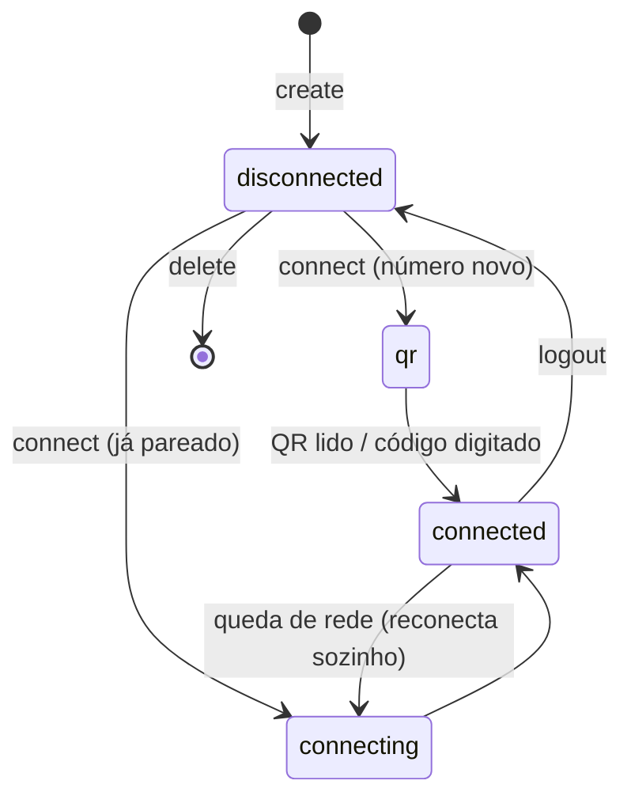

# Sessões

Uma **sessão** (ou *instância*) é um número de WhatsApp conectado ao Arcanum. Você pode ter
quantas a máquina aguentar; cada uma tem seu webhook, suas configurações e seu limite de
envio.

## Ciclo de vida



| Status | Significado |
|---|---|
| `disconnected` | Desconectada. Chame `connect`. |
| `qr` | Esperando a leitura do QR code (ou a digitação do código de pareamento). |
| `connecting` | Abrindo a conexão ou reconectando depois de uma queda. |
| `connected` | Pronta para enviar e receber. |

As sessões pareadas ficam guardadas em disco (`GATEWAY_DB_PATH`: `<nome>.db` para a sessão
do WhatsApp, `<nome>.json` para o webhook e as configurações) e **reconectam sozinhas quando o
Arcanum reinicia**, com a mesma configuração. Quedas de rede são retentadas
para sempre, com espera de até 30 segundos entre tentativas.

## Criar

```bash
curl -X POST http://localhost:3100/api/instance/create \
  -H "X-Api-Key: $ARCANUM_KEY" -H "Content-Type: application/json" \
  -d '{
        "instanceName": "vendas",
        "webhook": "https://seu-app.exemplo.com/webhooks/whatsapp/vendas"
      }'
```

| Campo | Obrigatório | Observação |
|---|---|---|
| `instanceName` | sim | 1 a 64 caracteres: `A-Z a-z 0-9 - _`. Vira nome de arquivo, então nada além disso é aceito. |
| `webhook` | não | URL de webhook desta sessão. Sem ela, vale `GATEWAY_WEBHOOK_FORWARD_URL`. |
| `webhookEvents` | não | Padrão `["messages", "status"]`. |

Responde `201` com a sessão, `409` se o nome já existe e `400` se o nome ou a URL do
webhook for inválido.

## Conectar

=== "QR code (JSON)"

    ```bash
    curl -H "X-Api-Key: $ARCANUM_KEY" http://localhost:3100/api/instance/connect/vendas
    ```

    ```json
    {
      "instanceName": "vendas",
      "status": "qr",
      "qr": "data:image/png;base64,iVBORw0KGgo..."
    }
    ```

    O campo `qr` entra direto numa imagem HTML: ``.

=== "QR code (PNG)"

    ```bash
    curl -H "X-Api-Key: $ARCANUM_KEY" \
      "http://localhost:3100/api/instance/connect/vendas?format=png" -o qr.png
    ```

=== "Código de pareamento"

    ```bash
    curl -X POST http://localhost:3100/api/instance/pair/vendas \
      -H "X-Api-Key: $ARCANUM_KEY" -H "Content-Type: application/json" \
      -d '{"phone": "5511999999999"}'
    ```

    Digite o `code` devolvido no WhatsApp: **Aparelhos conectados > Conectar um aparelho >
    Conectar com número de telefone**.

O QR code muda a cada ~20 segundos; consulte `connectionState` (ou `qr`) para mostrar o
mais recente. Chamar `connect` de novo enquanto espera devolve o QR atual: nunca abre uma
segunda conexão.

## Consultar

```bash
# Uma sessão
curl -H "X-Api-Key: $ARCANUM_KEY" http://localhost:3100/api/instance/connectionState/vendas

# Todas as sessões, com configurações e webhook
curl -H "X-Api-Key: $ARCANUM_KEY" http://localhost:3100/api/instance/fetchInstances
```

## Reiniciar, desconectar, apagar

| Ação | Rota | Efeito |
|---|---|---|
| Reiniciar | `POST /api/instance/restart/{nome}` | Reconecta. Nada para ler. |
| Desconectar | `DELETE /api/instance/logout/{nome}` | Derruba a conexão; a sessão continua pareada. |
| Apagar | `DELETE /api/instance/delete/{nome}` | Desconecta o aparelho do celular, fecha a sessão e remove os arquivos. Ela não volta depois de um reinício. |

!!! note "Desconectando pelo celular"
    Se você remover o aparelho em **WhatsApp > Aparelhos conectados**, a sessão fica
    inválida e precisa de um QR code novo. Apague no Arcanum e crie de novo.

## Configurações

```bash
curl -X POST http://localhost:3100/api/settings/vendas \
  -H "X-Api-Key: $ARCANUM_KEY" -H "Content-Type: application/json" \
  -d '{"groupsIgnore": true}'
```

| Configuração | Situação | Efeito |
|---|---|---|
| `groupsIgnore` | disponível | Mensagens de grupo não vão para o webhook. |
| `rejectCalls` | planejada | Guardada, ainda sem efeito. |
| `alwaysOnline` | planejada | Guardada, ainda sem efeito. |
| `readMessages` | planejada | Guardada, ainda sem efeito. |
| `readStatus` | planejada | Guardada, ainda sem efeito. |
| `syncFullHistory` | planejada | Guardada, ainda sem efeito. |

Hoje, mensagens de grupo, status (stories), listas de transmissão e canais nunca são
encaminhadas: o Arcanum é focado em conversas individuais.
