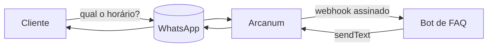
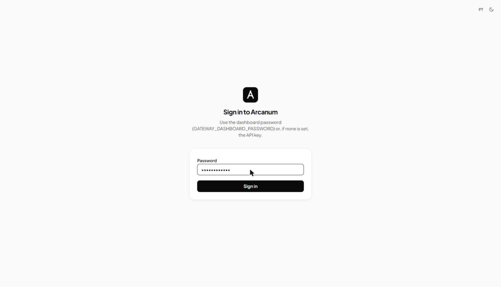
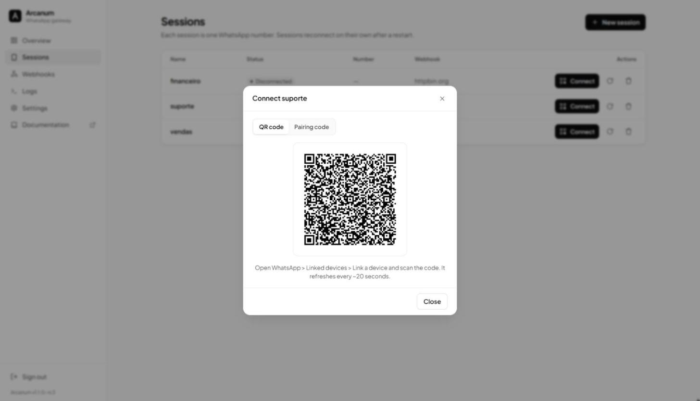
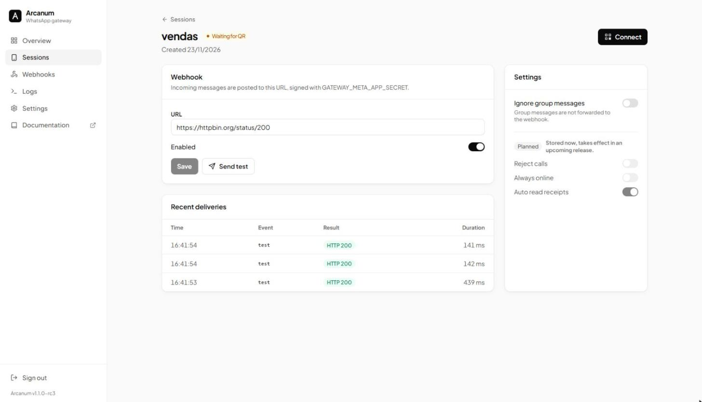
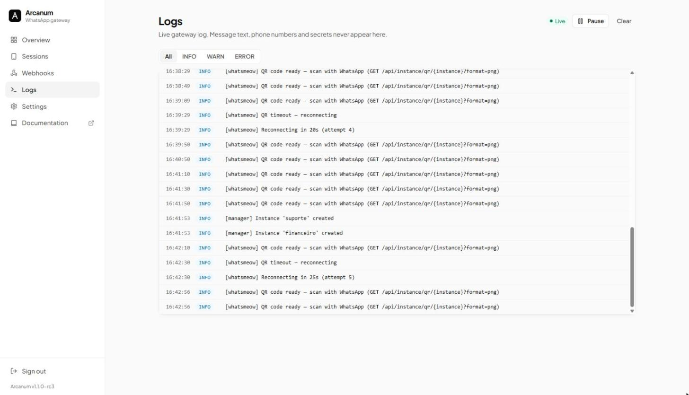

# Aula 1: seu primeiro bot

No fim você terá um número de WhatsApp respondendo perguntas frequentes sozinho, rodando na
sua máquina com o Arcanum e umas 100 linhas de Python.



## 1. Pegue o projeto

```bash
git clone https://github.com/rafaeldourado9/arcanum.git
cd arcanum/examples/faq-bot
cp .env.example .env
```

Preencha os três valores do `.env`, cada um com um texto aleatório diferente:

```bash
openssl rand -hex 32   # rode três vezes
```

| Variável | O que é |
|---|---|
| `ARCANUM_KEY` | Chave de API: o bot usa para enviar mensagens. |
| `ARCANUM_WEBHOOK_SECRET` | Assina cada webhook; o bot recusa o que não vier assinado com ele. |
| `DASHBOARD_PASSWORD` | Sua senha do painel. |

## 2. Suba tudo

```bash
docker compose up -d --build
```

Sobem dois containers: `arcanum` e `bot`. O Arcanum já vem configurado para entregar as
mensagens de todas as sessões ao bot (`GATEWAY_WEBHOOK_FORWARD_URL` no `compose.yaml`).

## 3. Conecte o número

Abra **http://localhost:3100** e entre com a `DASHBOARD_PASSWORD`.



Vá em **Sessões > Nova sessão**, chame de `demo` e clique em **Criar**. O QR code abre na
hora:



No celular do bot: **WhatsApp > Aparelhos conectados > Conectar um aparelho** e leia o
código. O status muda para **Conectada**.

!!! tip "Sem câmera?"
    Use a aba **Código de pareamento**: informe o número com código do país e digite o código
    de 8 caracteres em WhatsApp > Aparelhos conectados > Conectar com número de telefone.

## 4. Confira o webhook

Abra a sessão `demo` e clique em **Enviar teste**. Deve aparecer `Entregue: HTTP 200`, e a
entrega surge em **Entregas recentes**:



Se aparecer `HTTP 401`, o bot e o Arcanum estão com `ARCANUM_WEBHOOK_SECRET` diferentes.

## 5. Converse com ele

De outro celular, mande para o número do bot: **"qual o horário de funcionamento?"**. Alguns
segundos depois ("digitando...", pausa humana: é a camada [anti-ban](../anti-ban.md)) ele
responde com o horário do `faq.json`.

Teste "quanto custa?", "onde fica?" ou qualquer outra coisa para ver a resposta padrão.

## 6. Entenda o código

O bot inteiro é o [`app.py`](https://github.com/rafaeldourado9/arcanum/blob/main/examples/faq-bot/app.py).
As partes importantes:

```python
body = await request.body()
if not verify_signature(body, x_hub_signature_256):   # 1. só o Arcanum pode chamar
    raise HTTPException(status_code=401)

event = json.loads(body)
if event.get("from_me"):                               # 2. um humano respondeu: sai da frente
    paused_until[chat] = time.time() + HUMAN_PAUSE_SECONDS
    return {"ok": True}

background.add_task(reply, instance, chat, answer_for(event["text"]))  # 3. responde depois
return {"ok": True}                                    # 4. ...mas confirma agora
```

1. A assinatura é um HMAC-SHA256 do corpo bruto com o segredo compartilhado.
2. O `from_me` é assunto da [Aula 2](human-takeover.md).
3. `reply` chama `POST /api/message/sendText/{instance}` com a chave de API.
4. Responder o webhook rápido importa: o Arcanum espera no máximo 30 segundos.

## 7. Deixe com a sua cara

- Edite o `faq.json` e rode `docker compose restart bot`.
- Troque o `answer_for` por uma chamada a um modelo de IA; a estrutura continua igual.
- Acompanhe em **Logs** o que acontece enquanto testa:



**Próxima:** [Aula 2: atendimento humano](human-takeover.md).
