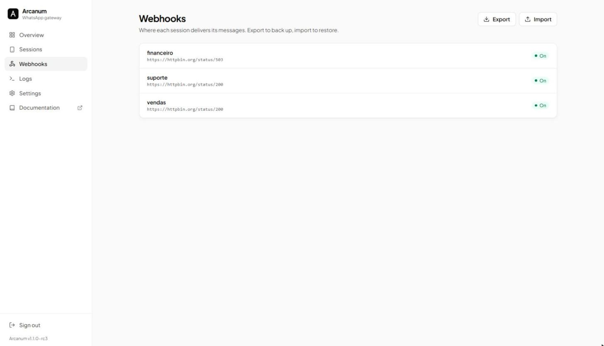
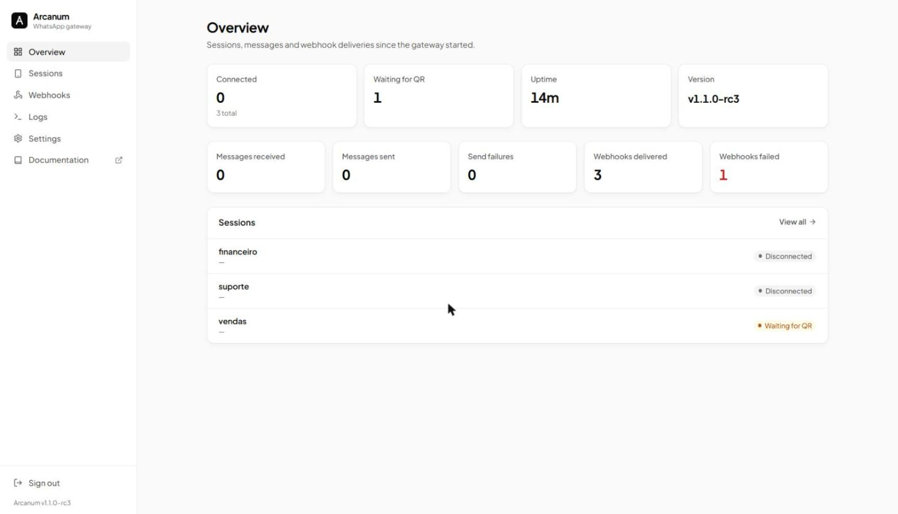

# Aula 4: trocar de servidor

Trocar de servidor não deveria significar pedir para cada número ler o QR code de novo. As
sessões do WhatsApp são arquivos: copie e elas voltam logadas.

## O que fica onde

| Item | Onde | Guarda |
|---|---|---|
| `<nome>.db` | volume de dados | A sessão do WhatsApp logada (chaves). |
| `<nome>.json` | volume de dados | Webhook e configurações da sessão. |
| Ambiente | `.env` / compose | Chave de API, senha do painel, segredo do webhook. |

## 1. No servidor antigo: backup

```bash
docker compose stop arcanum          # cópia limpa precisa do gateway parado
docker run --rm -v arcanum-data:/data -v "$PWD":/backup alpine \
  tar czf /backup/arcanum-data.tgz -C /data .
docker compose start arcanum         # volta ao ar enquanto você migra
```

Guarde também a configuração dos webhooks, que serve como registro legível:

```bash
curl -H "X-Api-Key: $ARCANUM_KEY" http://localhost:3100/api/events/webhooks/export -o webhooks.json
```

Ou pelo painel: **Webhooks > Exportar**.



!!! danger "O arquivo é um conjunto de contas de WhatsApp logadas"
    Criptografe antes de copiar (`age -p arcanum-data.tgz > arcanum-data.tgz.age`) e apague das
    duas máquinas quando terminar.

## 2. No servidor novo: restaure

```bash
# mesmo compose.yaml e .env de antes
docker volume create arcanum-data
docker run --rm -v arcanum-data:/data -v "$PWD":/backup alpine \
  sh -c "tar xzf /backup/arcanum-data.tgz -C /data && chown -R 65532:65532 /data"
docker compose up -d
```

## 3. Faça a troca

1. Desligue o Arcanum do servidor antigo **de vez** (`docker compose down`). A mesma sessão
   nunca pode rodar em dois servidores ao mesmo tempo: o WhatsApp derruba os dois.
2. Aponte o DNS (ou a `ARCANUM_URL` da sua aplicação) para o servidor novo.
3. Abra o painel: as sessões aparecem **Conectadas** em poucos segundos, com os mesmos
   webhooks.



## Só os webhooks?

Se você recriar as sessões (QR codes novos) mas quiser a mesma configuração de webhooks,
importe o arquivo exportado: **Webhooks > Importar**, ou

```bash
curl -X POST -H "X-Api-Key: $ARCANUM_KEY" -H "Content-Type: application/json" \
  --data @webhooks.json http://SERVIDOR-NOVO:3100/api/events/webhooks/import
```

Sessões que ainda não existem aparecem em `skipped`.

Você terminou o treinamento. A [referência da API](../api-reference.md) e a documentação
interativa em `/docs` cobrem todo o resto.
